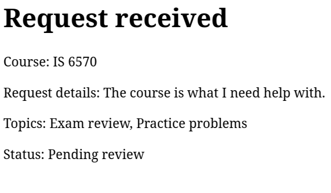

# Lab Four Notes

### Request Form Logic Description
Throughout the logic defined in the process-request.php file I can see some common trends. To begin we can see that there are no object oriented coding definitions in this file. The file contains mostly HTML with three "require once" php file calls. These file calls link to layout components. By using these files we can produce highly reusable code. If we ever need to update the these areas of reuse we need only to update the included specific file and it will propogate throughout the system. This reduces system overhead and maintance. The form itself makes a post request to 'process-request.php' which holds the associated logic for input santizing, input value checking, and the provided error reporting. This is a wonderful way to structure your business logic in a centralized location. 

### Trace the templates

1. The content provided to every page from header.php is the '<head>' tags. This provides information on the device width for the viewport, the associated boostrap stylesheet link, and the page title.

2. The content provided to every page from nav.php is the navigation bar. It provides the branded title, and a link to the Requests, and a link to the Request a Session page. Additionally, bootstrap classes were utilized without needing to link the stylesheet because it linked in the associated header.php.

3. The content provided in the footer.php to every page is tutoring hub footer. The content in this provides a bootstrapped container with the "Peer Tutoring Hub" text within it. Additionally, there is the bootstrap cdn script linked within it for javascript to be ran.

4. 'require_once' is appropriate for these scripts because if the system fails to locate the file it will generate a fatal error rather than a warning so it can be easier to identify issues. The Require once specifically is useful because it ensures that the script is ran only once. If multiple developers are working on a page it can cause miscommunications on who is handling implementation of aspects. Imagine if the header was ran 3 times for the three developers working on it. Now that code may still exist but it won't affect the user experience. 

5. The CSS files are linked in the header.php file. Both the boostrap stylesheet and the in house developed stylesheet can be found linked in the header.php.

### Observe the form controls

1. 'reason' - The reason field takes user input of a max length of 500 characters. PHP recieves a string type variable. The variable is santized by trimming it immediately. The PHP server double checks that the post it recieves adheres to the same client side based business rules by checking the string length.

2. 'topics[]' - The topics form section provides the user a list of topics to select for their appointment. When the form is submitted the PHP server will recieve an array of strings based on which check boxes were selected. If no checkbox is selected then the PHP server will get an empty array.

3. 'preferredtime' - The section on the HTML form is a radio box selection. The PHP server server will recieve a string of whichever time was selected.

4. 'preferreddate - The section on the HTML form provides the user a good boostrap interface for selecting a date. The PHP server will recieve a string for the date provided but is immedaitely converted to a DateTimeImmutable.

5. 'form_name' - This is a hidden value to the user on the HTML form that always submits "tutoring_request". This purpose of this is to limit malformed post requests to the server that someone may have crafted outside form. It could also become useful if you create one processing request field but have multiple forms post request to the validation system.

### Test Validation Behavior

##### Valid Requests
1. The values entered
I entered the following values:
- 'Exam Review' and 'Practice problems' for the Topics
- 'Morning' for the preferred time
- 'IS 6570' for the course
- '10/31/2026' which is todays date for the preferred date.
- 'The reason for this appointment is that I need help.' for the What would you like help with field.

2. The request was accepted

3. The message displayed by the application was that it was recieved with the status pending review.

4. The business rule being checked is the logic defined in process request. This inlcludes if the course is apart of the allowed courses, the time is amongst the allowed times, the reason string is greater than 10 characters, the reason string is below 500 characters, the date provided is not before today, and the topics selected are apart of the allowed topics.

##### Missing or invalid value
1. The values entered
I entered the following values:
- 'Exam Review' and 'Practice problems' for the Topics
- 'Morning' for the preferred time
- The course was left to it's default value.
- '10/31/2026' which is todays date for the preferred date.
- 'The reason for this appointment is that I need help.' for the What would you like help with field.

2. The form was not submitted.

3. The message displayed by the application is a pop up window "Please select an item in the list."

4. The business rule that was being checked before the form could ever get to the process-request logic was if the course was even selected on the form.

##### Past Date

1. The values entered
I entered the following values:
- 'Exam Review' and 'Practice problems' for the Topics
- 'Morning' for the preferred time
- 'IS 6570' for the course
- '10/30/2026' which is yesterdays date for the preferred date.
- 'The reason for this appointment is that I need help.' for the What would you like help with field.

2. The form was not submitted.

3. The message recieved by the application is "Request could not be submitted - preferred date cannot be in the past."

4. The business rule that provided this error message is located in the process-request.php and it makes a comparison of todays date against the formatted provided date. If it is not it provides an error message.

### Review Testing and CRUD pages
1. The validation-tests.php page of the system shows that valid time, missing time, altered value, multiple valid topics, missing topics, altered topic, minimum length, maximum length, too short, and too long. All tests report as passing.

2. The requests.php page allows an admin to see the requests made through the system. It appears that at this time it's just static information. The associated details pane allows an admin to view, edit, and cancel a request.

3. Identifying the page that represents each CRUD action:
- Create = request-form.php
- Read one request = request-details.php
- Read all requests = requests.php
- Update = edit-request.php
- Delete = delete-request.php

4. Follow-up questions
- In the request details url we can see an appened '?request-id=' followed up a numberical value.
- The GET query parameter is appropriate for viewing one request because we're asking the database to fetch data and return it to us. That is the core usage of a GET request.
- The Update and Delete should later use a POST command because a GET command is intended to indicate information is being fetched versus sent. We could alternatively use the HTTP rest method PUT for update or DELETE for the delete instead of POST to even further align with REST APIs.