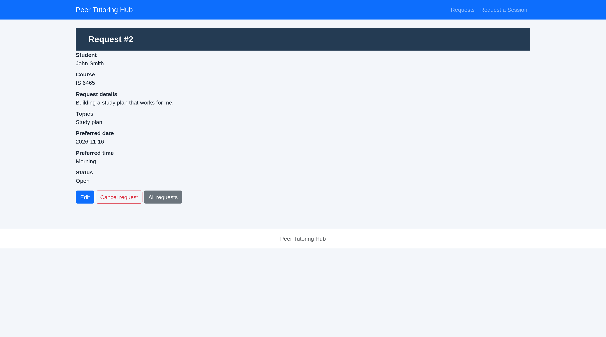

# Lab 6 Notes

### Part One, Commands used

The following commands were used to confirm that the database was configured as expected from the lab6 root:
- `sqlite3 database/tutoring.db < database/setup-database.sql`
    - This command creates the database.
- `sqlite3 database/tutoring.db`
    - This command utilizes sqlite3 CLI pointed at the newly created tutoring.db.
- `.tables`
    - This command used within sqlite3 shows us the tables withing the database file.
- `.quit`
    - This command exits the sqlite3 CLI now that we've confirmed the tables available to us.

### Part Two, Running the Application

1. The URL I used to open the application may not be the same as other students. I am using an IDE on my local machine over versus the codespaces in github. This allows me to work offline as needed. I used the command `php -S localhost:8000` instead of `php -S 0.0.0.0:8000` to start the php web server because I am working on a public wifi and binding the application to the default route address would allow anyone on the network to access the webserver which poses a security issue. To avoid such a problem I've started the php server under the loopback address which is localhost otherwise known as 127.0.0.1 so that the webserver is only accessible from my local machine. The URL that I use within the browser to access the web application is `http://localhost:8000` but if I were to use codespaces it would look something like `https://psychic-space-zebra-59446jgwx4jhxg9-8000.app.github.dev/` which provides some details, the first is the protocol https which encrypts trafic. The `psychic-space-zebra` is a codespace name. The `59446jgwx4jhxg9` appears to be a hash of some kind. The forwarded port is 8000 and `app.github.dev` is the codespace provider domain.

2. My request with test data was accepted into the database as request #2.

3. Screen shot of the `/request-details.php?request_id=2` page. 

### Part Three, Test the Web Application

| Test | What I Did | Expected Result | Actual Result | Pass or Fail |
| :--- | :--- | :--- | :--- | :--- |
| Submit a valid request | Utilized the request-form.php page with test data | A new tutoring request is created with status `Open`. | A status page was opened for request number two with the status `Open`. | PASS |
| View all requests | Utilized the requests.php page | The new request appears in the request list. | All of the requests in the database are present on the requests page. | PASS |
| Filter requests | Utilized the requests.php page filter bar. | Filtering by course or status shows matching requests. | All of the requests in the database matching the search critiera are present on the requests page and not when the filter doesn't match. | PASS |
| Edit an Open request | Utilized the edit-request.php page for a specific request and changed the values such as the course. | The revised values are displayed. |  The new course is displayed.   | PASS |
| Cancel an Open request | Utilized the cancel request button on the request-details.php page. | The request status changes to Cancelled. |  The updated status reflects cancelled.   | PASS |
| Try to edit or cancel a cancelled request | I first checked if the GUI of the web app showed an edit option for cancelled requests. Followed by modifiying the edit-request.php parameter for the cancelled request ID. | The application does not allow the change. | There is no GUI button to edit a cancelled request and navigating to the edit-request.php with the cancelled parameter is met by "Only Open requests may be edited." error message. | PASS |


### Part Four, Trace the request submission workflow

1. `php/request-form.php`
2. `php/process-request.php`
3. `config/db.php`
4. `services/requestService.php`
5. `repositories/studentPDO.php` and `repositories/requestPDO.php`
6. `students`
7. `tutoring_requests`
8. Through the `student_id` foreign key in `tutoring_requests` referencing `student_id` primary key in `students`.

Having our SQL statements in repository files allows us to keep our repository easy to read and maintain. When we seperate the SQL statements we're performing what is refered to as 'Seperation of Concerns' which allows us to easily recongize where the logic sits in our system. Keeping the statements seperate allows us to maintain it easier not just for readability but we're likely reusing the statements for other purposes allowing us to update a singular point for all shared uses.

### Part Five, Run the intergration tests

Output from `/tests/validation-tests.php`:
```text
PASS UC01 create and Open 
PASS Lab 4 checkbox values preserved 
FAIL Duplicate email reuses student 
FAIL UC02 course and status filter 
PASS Invalid reason rejected 
FAIL Invalid submission writes nothing 
PASS Edit Open request 
PASS Updated reason persisted PASS Cancel Open request 
PASS Cancelled row retained PASS Second cancellation rejected 
PASS Unrelated request unchanged 
PASS FK enforced 
PASS UC02 empty filter result 

FAILURES: 3 
```

We're experiencing failures on our intergration test because the test is using the setup-database.sql file which pre-seeds test data into the database. The tests expect a certain number of results and re-use the seeded data values. Removing the seeded values from the setup-database.sql that was provided yields the following output:

```text
PASS UC01 create and Open 
PASS Lab 4 checkbox values preserved 
PASS Duplicate email reuses student 
PASS UC02 course and status filter 
PASS Invalid reason rejected 
PASS Invalid submission writes nothing 
PASS Edit Open request 
PASS Updated reason persisted 
PASS Cancel Open request 
PASS Cancelled row retained 
PASS Second cancellation rejected 
PASS Unrelated request unchanged 
PASS FK enforced 
PASS UC02 empty filter result 

All integration checks passed 
```

This is the described expected output for this intergration test.

### Part Six, Use the AI skills pack process


#### Application Builder

**Prompt:**  
`Explain how a tutoring request moves from php/request-form.php through PHP, PDO, and SQLite in this project. Identify the responsibility of each file.`

**AI Response:**  
1. `php/request-form.php` presents the HTML form and submits user input via HTTP POST.
2. `php/process-request.php` verifies the POST request, calls `openDatabase()` from `config/db.php`, and invokes `submitRequest()`.
3. `config/db.php` creates and returns the configured SQLite PDO connection instance.
4. `services/requestService.php` validates input, opens a database transaction, and coordinates the repository calls.
5. `repositories/studentPDO.php` runs `INSERT OR IGNORE` and `SELECT` to ensure the student exists and fetch `student_id`.
6. `repositories/requestPDO.php` runs `INSERT INTO tutoring_requests` linked to `student_id` and returns the new `request_id`.
7. `database/tutoring.db` persists the records in SQLite while enforcing primary key, foreign key, and unique constraints.

**Evaluation:**  
- **Accurate Statement:** `services/requestService.php` validates input, opens a database transaction, and coordinates the repository calls.
- **Code Verification:** In `services/requestService.php`, `submitRequest()` begins with `$pdo->beginTransaction()`, inserts the student and request records in a `try` block, commits the values with `$pdo->commit()`, and rolls back in the `catch` block with `$pdo->rollBack()` if it fails.

---

#### Traceability Auditor

**Prompt:**  
`Trace the requirement “a student can submit a tutoring request” through the PHP files, service, repositories, SQLite tables, and integration tests in this project.`

**Traceability Matrix:**

| Requirement | Application Page | Service or Validation | Repository or SQL | Database Table | Test Evidence |
| :--- | :--- | :--- | :--- | :--- | :--- |
| Student submits a tutoring request | `php/request-form.php` which submits to `php/process-request.php` | `services/requestService.php` performs the services and validation | `repositories/studentPDO.php` which keeps our SQL statements seperate. | `students` & `tutoring_requests` are the two tables in our database. | `tests/integration-tests.php` runs our intergration and let's us know our system health for functionality. |

---

#### Test Harness Generator

**Prompt:**  
`Suggest one useful test case for the Peer Tutoring Hub application. The test must relate to request creation, filtering, editing, cancellation, validation, or database integrity.`

**Suggested Test Case:**  
**Reject editing a Cancelled request:** Verify that attempting to revise a request whose status is `Cancelled` fails and returns `false`.

**Evaluation:**
1. **Already covered by `tests/integration-tests.php`?**  
   No. The integration tests verify that a second *cancellation* fails (`!cancelOpenRequest()`), but never test whether `reviseRequest()` is rejected on a cancelled request.
2. **How to test:**  
   - **Manually:** Attempt to navigate to `php/edit-request.php?request_id=1` (a Cancelled request) in the browser; verify that it displays the error message `"Only Open requests may be edited."` and blocks the edit.
   - **Integration Test:** Add the following assertion to `tests/integration-tests.php` after the request is cancelled:
     ```php
     check(!reviseRequest($pdo, $id, $edit), 'Editing a Cancelled request is rejected');
     ```
3. **Appropriateness:**  
   I think it's appropriate. It enforces the business rule that closed or cancelled appointments must remain in it's current state for auditing and retention integrity. Right now we're testing to see if a open request can be edited or cancelled and if a cancelled request can be cancelled again but not if a cancelled request can be edited.

#### Reflection

I utilized AI to understand the tracing of the information. I used it by giving it the intial provided prompt but I proceeded to ask it questions. Asked it to locate design patterns in the files and where logic lied within the repository. This sped up my time to understanding as it allowed me to interpret the information in human readable text versus navigating the repository logic. I did verify it's statements and the code it was providing to me in example snippets because AI has the potential to halicinate. It did modify the syntax of the code snippet it provided to me but logically it remained the same sentiment.

### Part Seven, Inspect the database

```SQL
SELECT
    r.request_id,
    s.student_name,
    s.student_email,
    r.course,
    r.topic,
    r.preferred_date,
    r.preferred_time,
    r.status
FROM tutoring_requests AS r
JOIN students AS s
    ON r.student_id = s.student_id
ORDER BY r.request_id;
```

Given the query provided above we can see that this statement joins two tables to provide a specific view. The view is taking the requests table and adding the student name and email from the student table that correlates to the same shared key, the student_id. It proceeds to order the list by the request ID.
