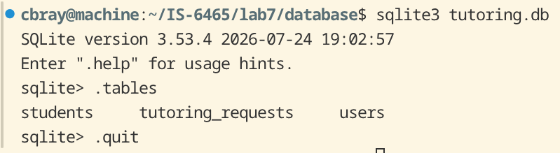
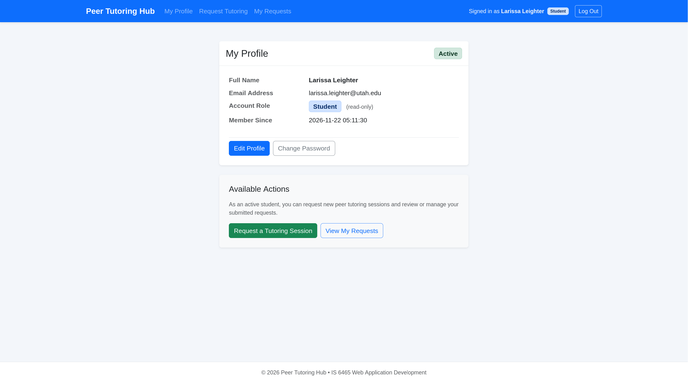
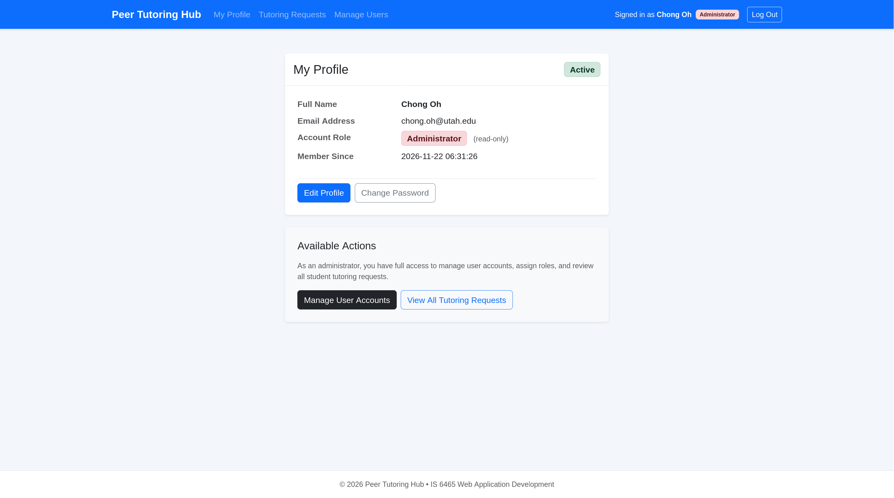

# Lab 7 Notes

### Part One, Generate the Lab 7 Application

1. AI prompts used:

My starting prompt to kick this project off with was:
```text
Reference the skills pack. Everything you'd need is within the parent folder IS-6465.

Generate code for all user management use cases UM-01 through UM-10 in the User Management Design Document.

Use the Application Builder, Test Harness Generator, and Traceability Auditor documents as implementation guidance. Follow the authentication, authorization, session management, password hashing, CSRF protection, and role based access practices in the Authentication Reading Handout.

Use lab7 as the existing Peer Tutoring Hub application to extend. Preserve the Lab 7 three tier architecture and update the application as needed to support user registration, login, logout, profile management, administrator access, and protected tutoring request workflows.

Return a complete Lab 7 application package with all updated and new files.
```

Cosmetic fixes were quickly prompt queued as I browsed the pages as the administrator. I was able to rapidly convey the changes I wanted and I could double back and review what the agent worked on so that I could further adjust by hand what it failed to accurately capture. These prompts included:

```text
Fix the footer so it sticks to the bottom of the page if there isn't enough content to make it scroll.
```

```text
Change the login layout so that the email and password are not inline but stacked per modern design. "Log In to Peer Tutoring Hub" is hard to view on that screen due to not enough contrast. Find any other examples of this level of contrast like the "My Profile" as well.
```

```text
Go through and fix the button sizes on the user-role.php. They're too big for the form size. Reference google's modern web design docs for propotional asset sizing for accessibility.
```

```text
Ensure that all drop down menus are wide enough to accomodate the text within them comfortably.
```

```text
Fix the filter location on the users.php page and the requests page. It's aligned left. It needs to be centered. Rework it as needed to conform to modern web design.
```


I was able to capture the requirements of project by having the agent browse the documentation and provide rapid results.
```text
Check the docs and report back: Is the "Classroom Demo Accounts:" a requirement of the project?
```

2. The list of the uploaded source files

Lab 7 source files and folder structure
```text
lab7/
├── config/
│   └── db.php
├── css/
│   └── styles.css
├── database/
│   ├── create-admin.php
│   ├── setup-database.sql
│   └── tutoring.db
├── includes/
│   ├── auth.php
│   ├── footer.php
│   ├── header.php
│   ├── nav.php
│   └── validation.php
├── php/
│   ├── change-password.php
│   ├── delete-request.php
│   ├── edit-profile.php
│   ├── edit-request.php
│   ├── login.php
│   ├── logout.php
│   ├── process-request.php
│   ├── profile.php
│   ├── register.php
│   ├── request-details.php
│   ├── request-form.php
│   ├── requests.php
│   ├── router.php
│   ├── update-request.php
│   ├── user-delete.php
│   ├── user-role.php
│   ├── user-status.php
│   └── users.php
├── repositories/
│   ├── requestPDO.php
│   ├── studentPDO.php
│   └── userPDO.php
├── services/
│   ├── requestService.php
│   └── userService.php
├── tests/
│   ├── integration-tests.php
│   └── validation-tests.php
├── index.php
├── IS6465_Authentication_Reading_Handout_v1.2_[16Nov2026].pdf
├── lab7-notes.md
├── Peer_Tutoring_Hub_User_Management_With_Diagrams.docx
└── README.md
```

3. The explanation of how Lab 7 extends the Lab 6 application

Lab seven expands lab 6 in a multitude of ways primarily in user management and authorization. In the realm of user management we've introduced an administrative intiailizer script and an administrative role that can manage other users. For authorization we've introduced RBAC controls ensuring that only users authorized to see a page, view, or data can actually see that before the page has ever been rendered for them. We've implemented Bcrypt password hashing to ensure we have no passwords stored in plaintext. We've intergrated secure sessions for every page. 

4. One example of generated code or a generated file that I verified against the design document or reading handout

Every line of code that AI creates I check it for quality in UI/UX and adherance to business rules. Specifically I checked our specifications document to ensure that users were allowed to update their own accounts as well without any form of approval. This turned out to be accurate under use case UM-04.

### Part Two, Set Up the Database

1. Database set up commands used:
`cd lab7/database`

`sqlite3 tutoring.db < setup-database.sql`

`sqlite3 tutoring.db < upgrade-to-user-management.sql`

2. Using the commands above I can attest that all the database has been initialized to the specifications needed for this project.

3. Screenshot of the commands and output:


### Part Three, Create an Administrator Account

1. The command structure I used was `php create-admin.php "Test Administrator" admin@example.com "TestPassword123"` which allowed me to adapt it to the name, email, and password desired.

2. I can attest that the administrative account was created through the php creation script.

3. The email I used was `Chong.Oh@utah.edu` for this administrative account.

4. The role was automatically assigned the administrative role since it was created from the `create-admin.php` script in the server CLI.

### Part Four, Run the Application

1. The browser URL that I opened was `http://localhost:8000` since I am running this server locally on my laptop compared to over codespaces. 

2. The application was successfully started and when I navigated to the before mentioned root address it redirected me to the login.php page. This confirms the logic in play forcing users to authenticate.

3. When I try to navigate directly to `http://localhost:8000/php/requests.php` I am immediately redirect to the login.php page to authenticate.

### Part Five, Test the Student Workflow

| Test | What I Did | Expected Result | Actual Result | Pass or Fail |
| :--- | :--- | :--- | :--- | :--- |
| Register student account | I navigated to the `register.php` page and filled out the form witht est data. | Student account is created | The student account was successfully created it reports. | PASS |
| Log in as student | Using the credentials used with the `register.php` form on the `login.php` form | Student can access protected student pages | I am able to sign in as the user previously defined in the registration. | PASS |
| View or update profile | Updating the user profile | Profile information is displayed or saved | I was immediately directed to the `profile.php` page which showed the user information filled out on `register.php` but I attempted to update the users email which was successful. | PASS |
| Create tutoring request | Creating a tutoring request as the previously registered user | A new request is created with status Open | I filled out the tutoring request form and submitted it successfully. | PASS |
| Edit Open request | I attempted to change the date of the request I previously created. | Updated request information is displayed | I was able to update the request date. | PASS |
| View my requests | Navigating to `requests.php` | Student sees the student’s own requests | I only see the requests I've created for this user | PASS |
| Log out | Pressing the logout button | Session ends and login page appears | Upon pressing the logout button I was redirected to the login page. When I attempted to go back to the requests page I was stuck being redirected to the login again. | PASS |

Screenshot of the user profile page that I registered:


### Part Six, Test the Administrator Workflow

1. Authentication in this system is when a user provides the needed credentials and a secure session is updated to reflect their account information.

2. Authorization on the other had is the role the user has been given and what actions or views that user is afforded.

3. A student differs from an administrator in this system by what they're authorized to see and do within the system. Students can see their own requests and managing their own profile data. An administrator can see all requests and manage other users roles and data. Both users are authenticated but only one is authorized to see the entire requests list.

4. The manage users page is restricted to administrators because it entails modifying other user roles and information along with the ability to delete users from the system. Additionally, viewing a students tutoring request as an administrator allows them to modify or cancel their request whereas a student cannot do the same for requests they are not the creator of.

5. If a user logs out and attempts to view or post request to a page that they lack the permissions to they'll be redirected to the login page. The purpose is to authenticate and authorize the request they previously were seeking to complete.

Administrative User Profile Page:


### Part Seven, Trace Registration and Login

Student registration workflow:
1. `php/register.php` (GET request) displays the Create Account form.
2. `php/register.php` (POST request) receives the submitted registration form.
3. `includes/auth.php` contains `csrfToken()` to create and retrieve the token, and `verifyCsrfToken()` to verify it using `hash_equals()`.
4. `services/userService.php` (`registerUser()`) validates the registration information using helpers in `includes/validation.php`.
5. The password is hashed in `services/userService.php` inside `registerUser()` using `password_hash($input['password'], PASSWORD_DEFAULT)`.
6. `repositories/userPDO.php` (`insertUser()`) and `repositories/studentPDO.php` (`insertStudentWithUserId()`) insert user and student data.
7. Both the `users` and `students` tables receive records when a student registers.

User login workflow:
1. `php/login.php` (GET request) displays the login form.
2. `php/login.php` (POST request) receives the submitted login credentials.
3. `repositories/userPDO.php` (`findUserByEmail()`) retrieves a user by email address.
4. The submitted password is verified in `services/userService.php` inside `authenticateUser()` using `password_verify($password, $user['password_hash'])`.
5. After successful login, the session ID is regenerated (`session_regenerate_id(true)`), and session variables (`user_id`, `role`, `display_name`, `last_activity`) are populated.
6. The application regenerates the session ID to prevent session fixation attacks, ensuring an attacker cannot authenticate into a session ID established before login.
7. The application checks `$_SESSION['role']` against allowed roles using `requireRole($user, $allowedRoles)`.

Password hashing and verification must occur in the app service layer to centralize authentication logic and separate security rules from presentation and database storage. Placing hashing in the service layer ensures salting and hashing are applied before credentials touch persistence, preventing plaintext exposure in SQL logs or database scripts. This keeps presentation lightweight while maintaining a single, testable authority for credential validation.

### Part Eight, Run the Automated Tests

1. Validation tests (`php tests/validation-tests.php`):
Output:
```text
PreferredTime: Valid Morning: PASS

PreferredTime: Valid Afternoon: PASS

PreferredTime: Valid Evening: PASS

PreferredTime: Missing time: PASS

PreferredTime: Altered value: PASS

Topics: Multiple valid topics: PASS

Topics: Single valid topic: PASS

Topics: Missing topics (empty array): PASS

Topics: Altered topic string: PASS

Reason: Minimum length (10 chars): PASS

Reason: Maximum length (500 chars): PASS

Reason: Too short (9 chars): PASS

Reason: Too long (501 chars): PASS

Password: Valid length (8 chars): PASS

Password: Valid long password: PASS

Password: Too short (7 chars): PASS

Password: Empty string: PASS

Email: Valid standard email: PASS

Email: Valid sub-domain email: PASS

Email: Missing email: PASS

Email: Invalid format (no @): PASS

FullName: Valid standard name: PASS

FullName: Empty name: PASS

FullName: Whitespace only: PASS

FullName: Exceeds 120 chars: PASS
```
All validation tests passed.

2. User management tests (`php tests/user-management-tests.php`):
This test suite was not provided in lab6.zip but I had generated from the specifications documents.

Output:
```text
Seed: Admin account loaded with Active status: PASS

Seed: Student account loaded with Active status: PASS

Seed: Tutor account loaded with Active status: PASS

Seed: Inactive account loaded with Inactive status: PASS

UM-01: Student self-registration creates Active account: PASS

UM-01: Registered password hash verifies correctly: PASS

UM-01: Student registration links record in students table: PASS

UM-01: Tutor self-registration creates Active account: PASS

UM-01: Duplicate email rejected: PASS

UM-01: Public registration cannot grant Administrator role: PASS

UM-01: Password confirmation mismatch rejected: PASS

UM-01: Password under 8 characters rejected: PASS

UM-09: Valid credentials authenticate successfully: PASS

UM-09: Email login is case-insensitive: PASS

UM-09: Invalid password returns null: PASS

UM-09: Unknown email returns null: PASS

UM-09: Inactive user account is denied authentication: PASS

UM-02: User profile returns accurate name, email, and role: PASS

UM-02: Non-existent user profile returns null: PASS

UM-04: Profile name and email updated: PASS

UM-04: Linked student record synchronized with profile update: PASS

UM-04: Colliding email update rejected: PASS

UM-05: New password authenticates successfully: PASS

UM-05: Old password rejected after change: PASS

UM-05: Wrong current password rejected: PASS

UM-05: New password confirmation mismatch rejected: PASS

UM-03: Admin list returns all users: PASS

UM-03: Search by keyword returns matching user: PASS

UM-03: Filter by Tutor role returns tutors: PASS

UM-03: Filter by Inactive status returns inactive accounts: PASS

UM-03: Non-matching search returns empty array: PASS

UM-06: Administrator can update user role: PASS

UM-06: Role change can re-assign Student role: PASS

Precondition: Exactly one active administrator exists: PASS

UM-06: Demoting sole active administrator is blocked: PASS

UM-07: Administrator can deactivate an account: PASS

UM-07: Deactivated user cannot authenticate: PASS

UM-07: Administrator can reactivate an account: PASS

UM-07: Reactivated user can authenticate: PASS

UM-07: Deactivating sole active administrator is blocked: PASS

UM-08: Admin deleting own account is blocked: PASS

Precondition: Maria Lopez has associated tutoring requests: PASS

UM-08: Deletion of user with tutoring requests blocked by retention policy: PASS

Precondition: Franklin has no tutoring requests: PASS

UM-08: User without tutoring requests can be deleted: PASS

UM-10: CSRF token is cryptographically secure (64 hex chars): PASS

UM-10: CSRF token is consistent within session: PASS

UM-10: SQLite foreign keys strictly enforced: PASS
```
All tests passed.

3. Integration tests (`php tests/integration-tests.php`):
Output:
```text
=== IS 6465 Lab 7: Automated Integration Test Suite === PASS: Seed: Admin account loaded PASS: Seed: Student Maria loaded PASS: Seed: Tutor Taylor loaded PASS: Seed: Inactive account loaded PASS: UM-01: Student self-registration creates Active user PASS: UM-01: Stored password hash verifies correctly PASS: UM-01: Student registration links students table row PASS: UM-01: Tutor self-registration creates Active user PASS: UM-01: Duplicate email rejected PASS: UM-01: Public registration cannot grant Administrator role PASS: UM-01: Password mismatch rejected PASS: UM-01: Short password rejected (min 8 chars) PASS: UM-09: Valid credentials authenticate successfully PASS: UM-09: Email login is case-insensitive PASS: UM-09: Invalid password returns null PASS: UM-09: Unknown email returns null PASS: UM-09: Inactive user account is denied login PASS: UM-02: Own profile returns accurate name, email, role, and status PASS: UM-04: Profile name and email updated PASS: UM-04: Student record synchronized with profile update PASS: UM-04: Colliding email update rejected PASS: UM-05: New password authenticates PASS: UM-05: Old password rejected after change PASS: UM-05: Wrong current password rejected PASS: UM-05: New password mismatch rejected PASS: UM-03: Admin list returns all users PASS: UM-03: Search by keyword returns matching user PASS: UM-03: Filter by Tutor role returns tutors PASS: UM-03: Filter by Inactive status returns inactive accounts PASS: UM-03: Empty search returns empty array PASS: UM-06: Admin can update user role PASS: Precondition: Exactly one active administrator exists PASS: UM-06: Demoting sole active administrator is blocked PASS: UM-07: Admin can deactivate an account PASS: UM-07: Deactivated user cannot authenticate PASS: UM-07: Admin can reactivate an account PASS: UM-07: Reactivated user can authenticate PASS: UM-07: Deactivating sole active administrator is blocked PASS: Tutoring: Student can submit request linked to user_id PASS: Tutoring: Student can view their own Open request PASS: Tutoring: Checkbox topic values preserved in JSON PASS: Tutoring: Ownership rule prevents student from viewing peer request PASS: Tutoring: Administrator can view any request PASS: Tutoring: Student can edit own Open request PASS: Tutoring: Revised reason persisted PASS: Tutoring: Peer student cannot edit another student request PASS: Tutoring: Student can cancel own Open request PASS: Tutoring: Request status updated to Cancelled PASS: Tutoring: Cancelled request row is retained in database PASS: Tutoring: Second cancellation on cancelled request rejected PASS: Tutoring: Editing a Cancelled request rejected PASS: Precondition: Charlie Brown has associated tutoring request records PASS: UM-08: Deletion of user with tutoring requests blocked by retention policy PASS: UM-08: Admin deleting own account is blocked PASS: Precondition: Linus has no tutoring requests PASS: UM-08: User without tutoring requests can be deleted PASS: Security: SQLite foreign keys enforced PASS: Security: CSRF token generated and consistent within session === Test Results === Passed: 58 Failed: 0 
```
All tests passed.

### Part Nine, Use the AI Skills Pack Process

1. Application Builder:
- Prompt: "Explain how a student registration request moves from register.php through authentication checks, PHP services, repositories, PDO, and SQLite in the Peer Tutoring Hub application. Identify the responsibility of each file or layer."
- AI response summary: The request begins at `register.php`, which verifies the CSRF token and passes POST data to `userService.php` (`registerUser()`). `userService` validates inputs and hashes the password via Bcrypt. It calls `userPDO.php` (`insertUser()`) to write the user record, and then `studentPDO.php` (`insertStudentWithUserId()`) to create the linked student profile using parameterized queries through PDO into SQLite.
- Accurate statement & verification:
  - Statement: When a user registers as a Student, `userService.php` persists the account in `users` via `insertUser()`, and immediately inserts a linked student record in `students` via `insertStudentWithUserId()`.
  - Verification: Confirmed in `services/userService.php` lines 50 to 56:
    ```php
    $userId = insertUser($pdo, $fullName, $email, $hash, $role);
    if ($role === 'Student') {
        insertStudentWithUserId($pdo, $fullName, $email, $userId);
    }
    ```

2. Traceability Auditor:
- Prompt: "Trace the requirement 'a student can register, log in, create a tutoring request, and log out' through the presentation pages, authentication code, services, repositories, SQLite tables, and automated tests in this project."
- Completed traceability table:

| Requirement | Presentation Page | Authentication or Authorization | Service or Validation | Repository or SQL | Database Table | Test Evidence |
| :--- | :--- | :--- | :--- | :--- | :--- | :--- |
| **Student registers an account** | `php/register.php` | `csrfToken()`, `verifyCsrfToken()` | `registerUser()`, `validateFullName()`, `validateEmail()`, `validatePasswordStrength()` | `insertUser()`, `insertStudentWithUserId()` | `users`, `students` | `integration-tests.php`: "UM-01: Student self-registration creates Active user" |
| **Student logs in** | `php/login.php` | `verifyCsrfToken()`, `session_regenerate_id()`, `startSecureSession()` | `authenticateUser()`, `password_verify()` | `findUserByEmail()` | `users` | `integration-tests.php`: "UM-09: Valid credentials authenticate successfully" |
| **Student creates a tutoring request** | `php/request-form.php`, `php/process-request.php` | `requireLogin()`, `requireRole(['Student'])`, `verifyCsrfToken()` | `submitRequest()`, `validatePreferredTime()`, `validateTopics()`, `validateReason()` | `insertRequest()` | `requests`, `students` | `integration-tests.php`: "Tutoring: Student can submit request linked to user_id" |
| **User logs out** | `php/logout.php` | `logoutSession()`, `session_destroy()`, cookie expiry | `logoutSession()` in `includes/auth.php` | N/A (Session memory / browser cookie) | N/A | Manual logout test & session destruction verification |

3. Test Harness Generator:
- Prompt: "Suggest one useful test case for authentication or authorization in the Peer Tutoring Hub application. The test must relate to registration, login, logout, session protection, role based access, password validation, CSRF protection, or account status."
- Suggested test: Verify that an active session is immediately rejected if an administrator deactivates the user account mid-session.
- Explanation:
  - Coverage: `integration-tests.php` covers `UM-07: Deactivated user cannot authenticate` and `UM-09: Inactive user account is denied login`, but does not test real-time session invalidation on subsequent page requests.
  - Testing method: Test manually by logging into a student session, changing status to 'Inactive' via administrator, and refreshing the student page to confirm redirection to `login.php?inactive=1`. In automated testing, invoke `requireLogin()` with a mocked session after running `updateUserStatus($pdo, $id, 'Inactive')`.
  - Appropriateness: very appropriate for validating that session authorization checks database state rather then relying solely on static cookie values.

4. Skills Pack Reflection:
The AI tool accelerates architectural tracing by identifying dependencies between presentation routes, services, and repositories. It helps systematically map business requirements against code paths and automated test cases. However, AI responses frequently generalize workflows or reference patterns that do not match the actual codebase. Developers have to verify every assert generated against the actual repository files, database schema, and test suite to prevent false assumptions and ensure complete architectural integrity.

### Part Ten, Inspect the Database

Database query output:
`"SELECT u.user_id, u.full_name, u.email, u.role, u.status, s.student_id, s.student_name, s.student_email FROM users AS u LEFT JOIN students AS s ON u.user_id = s.user_id ORDER BY u.user_id;"`

```text
user_id  full_name           email                     role           status    student_id  student_name      student_email
1        Cade                admin@example.edu         Administrator  Active    NULL        NULL              NULL
2        Taylor Lee          tutor@example.edu         Tutor          Active    NULL        NULL              NULL
3        Student Sam         student@example.edu       Student        Active    2           Student Sam       student@example.edu
4        Maria Lopez         maria.lopez@example.com   Student        Active    1           Maria Lopez       maria.lopez@example.com
5        Inactive Ian        inactive@example.edu      Student        Inactive  NULL        NULL              NULL
6        Larissa Leighter    larissa.leighter@utah.edu Student        Active    3           Larissa Leighter  larissa.leighter@utah.edu
7        Test Administrator  admin@example.com         Administrator  Active    NULL        NULL              NULL
8        Chong Oh            chong.oh@utah.edu         Administrator  Active    NULL        NULL              NULL
```

1. What the LEFT JOIN does:
It returns all records from `users` with the matching rows from `students`. If no matching row exists in `students`, `NULL` is returned for the student columns.

3. How the users table connects to the students table:
From the `students.user_id` as a foreign key referencing `users.user_id`.

4. Why the application stores account information separately from student profile information:
To enforce normalization and separation of concerns, the `users` holds authentication and authorization credentials common to all user types, whereas `students` contains domain specific profile data required for tutoring requests.

5. Why an administrator account may not have a matching row in the students table:
Administrators manage the system and do not participate in tutoring sessions and as such creating a student record for an administrator would introduce unnecessary data.
